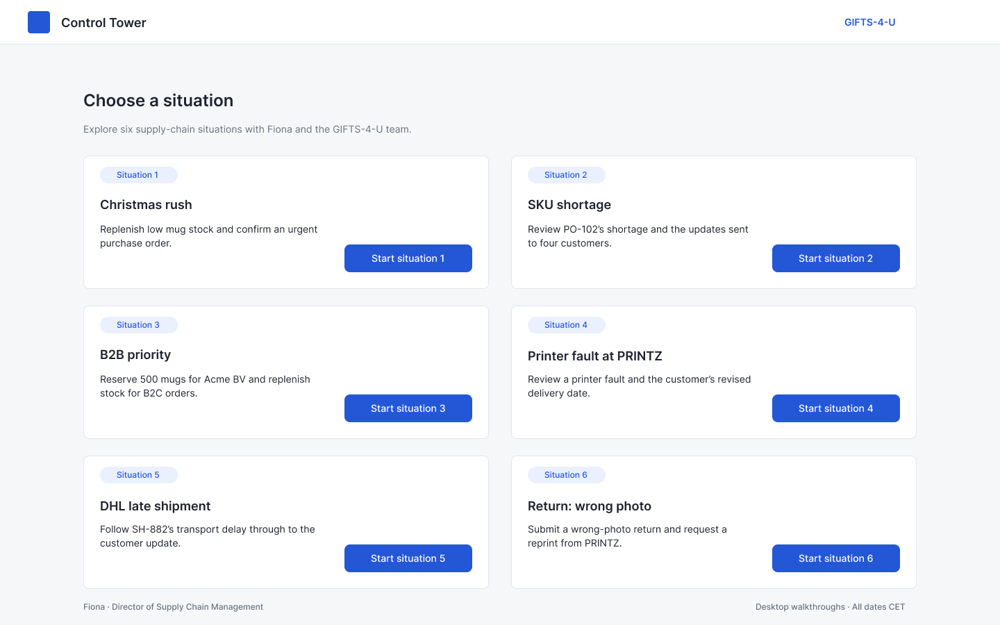
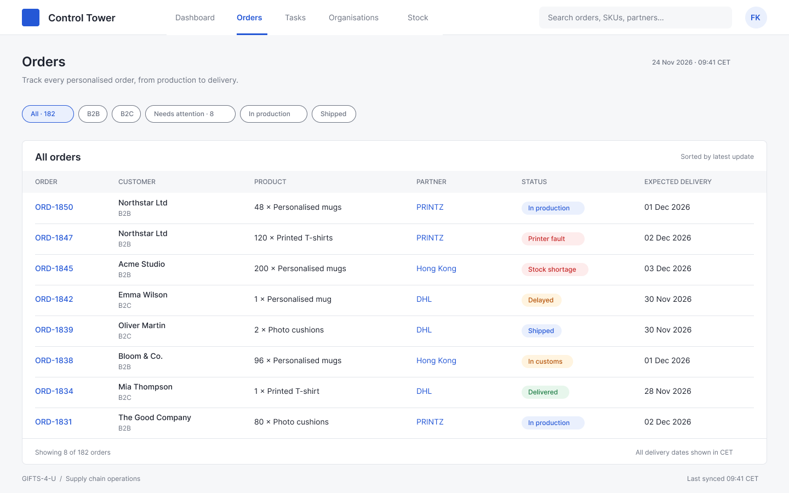

# Prototype

High-fidelity, clickable prototype of the Control Tower and webshop for situations 1–6.

**Figma (clickable):** https://www.figma.com/design/LcL2jfRR8PBWRim1kKnYaz/prototype?t=z0G97AdUJKZ7B1Do-1

Open the link, press **Present** (▶) and start from "Start · Choose a situation".

PO-N - Purchase Order, N - order number

| Situation | Flow |
|---|---|
| 1 Christmas rush | Dashboard popup -> Tasks -> New purchase order -> PO-104 confirmed |
| 2 SKU shortage | Dashboard popup → Affected orders -> PO-102 out of stock -> Customer view |
| 3 B2B priority | Dashboard popup -> B2B task -> Orders -> PO-105 confirmed |
| 4 Printer fault | Dashboard popup -> Tasks -> PRINTZ -> Customer view |
| 5 DHL late shipment | Dashboard popup -> Tasks -> DHL -> Customer view |
| 6 Return: wrong photo | Return form -> Confirmation -> Dashboard popup -> Tasks -> PRINTZ reprint |

## When you start presenting

**Start · Choose a situation**

The first screen when you press Present. Pick the situation you want to showcase.

**Dashboard**

Overview of open orders, late orders, stock and recent updates. Alerts appear here as a popup.

**Orders**

All customer orders, B2B and B2C, with their status and delivery date.

**Tasks & exceptions**

Open tasks that need action, B2B first.

**Stock**

Stock levels per SKU and which products are below their reorder threshold.

**Organisations · Hong Kong**

Purchase orders at Hong Kong Novelty Goods, with their status and expected arrival.

**Organisations · PRINTZ**

Production orders at PRINTZ, with their status and estimated completion.

**Organisations · DHL**

Shipments with DHL, with their route, status and expected arrival.

**My order · ORD-1842**

The webshop page where a customer follows their order.

## Wireflows

### Situation 1 – Christmas rush

During the Christmas rush, orders rise sharply and mugs (02 L W) drop below their reorder threshold. Fiona sees the warning, opens the task and sends an urgent purchase order to Hong Kong.

**1 Christmas-rush alert**

A popup warns that mugs are running low. Fiona clicks View task.

**2 Replenishment tasks**

The mug task is at the top of Open tasks. Fiona clicks the next action to order from Hong Kong.

**3 New purchase order**

On the Hong Kong page, Fiona fills in an urgent purchase order and submits it.

**4 PO-104 confirmed**

The new purchase order PO-104 appears with its expected arrival.

### Situation 2 – SKU shortage

Hong Kong Novelty Goods reports that a T-shirt variant (03 M P) is out of stock. Fiona sees which customer orders are affected and the new arrival date, and customers get the new delivery date automatically.

**1 Supplier-shortage alert**

A popup reports that PO-102 is out of stock at the supplier. Fiona clicks View task.

**2 Affected customer orders**

The task shows which customer orders are affected by the shortage.

**3 PO-102 out of stock**

On the Hong Kong page, PO-102 is marked out of stock with the new arrival date.

**4 Customer ORD-5543**

The customer sees the new delivery date for their order.

### Situation 3 – B2B priority

A large B2B order competes with B2C orders for the same mugs. B2B always gets priority, so the stock is reserved for the B2B order and the B2C customers get new delivery dates automatically.

**1 New B2B-order alert**

A popup announces a large B2B order for 500 mugs. Fiona clicks View task.

**2 B2B priority task**

The B2B task is at the top of Open tasks. Fiona reserves the stock for the B2B order.

**3 Stock reserved for B2B**

The stock goes to the B2B order, and the B2C orders waiting for mugs get new delivery dates.

### Situation 4 – Printer fault

PRINTZ reports a printer fault on line 2, so production of PR-211 is 2 days late. Fiona sees the warning, opens the task and checks the delay on the PRINTZ page. The customer gets the new delivery date automatically.

**1 Dashboard alert**

A popup warns about the printer fault at PRINTZ. Fiona clicks View task.

**2 Printer-fault tasks**

The printer fault task is at the top of Open tasks. Fiona clicks Open PR-211.

**3 PRINTZ production**

The PRINTZ page shows the production problem and the 2-day delay.

**4 Customer ORD-5530**

The customer sees the new delivery date for their order.

### Situation 5 – DHL late shipment

DHL is short of capacity at the Middelburg depot, so shipments arrive 1 day late. Fiona opens the task and sees which shipments are delayed on the DHL page. The customer gets the new delivery date automatically.

**1 DHL dashboard alert**

A popup warns about late DHL shipments. Fiona clicks View task.

**2 DHL late-shipment tasks**

The late shipment task is at the top of Open tasks. Fiona clicks Open SH-880.

**3 DHL shipments**

The DHL page shows the transport problem and which shipments are delayed.

**4 Customer ORD-5534**

The customer sees the new delivery date for their order.

### Situation 6 – Return: wrong photo

A customer receives a mug with the wrong photo and asks for a return. The return automatically becomes a task for staff, and Fiona asks PRINTZ to reprint the item.

**My order ORD-5530**

The customer opens their delivered order and clicks Return an item.

**1 Return an item**

The customer chooses Wrong product / wrong photo, adds a photo and submits the return.

**2 Return confirmation**

The confirmation shows what happens next: the return is reviewed, PRINTZ reprints the item, and the customer gets a new delivery date.

**3 New return alert**

A popup warns staff about the new return. Fiona clicks View task.

**4 Request reprint**

The return task is at the top of Open tasks. Fiona requests a reprint from PRINTZ.

**5 PRINTZ reprint requested**

On the PRINTZ page, the reprint is added with its completion date.

