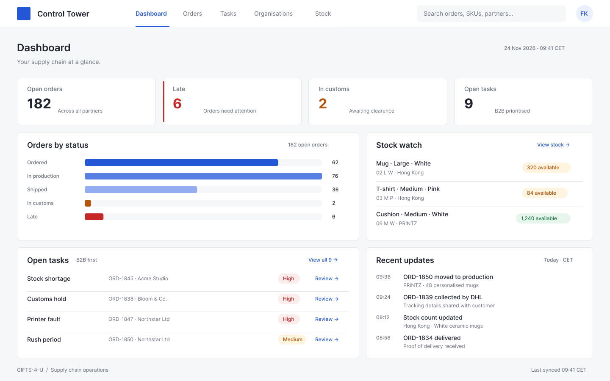
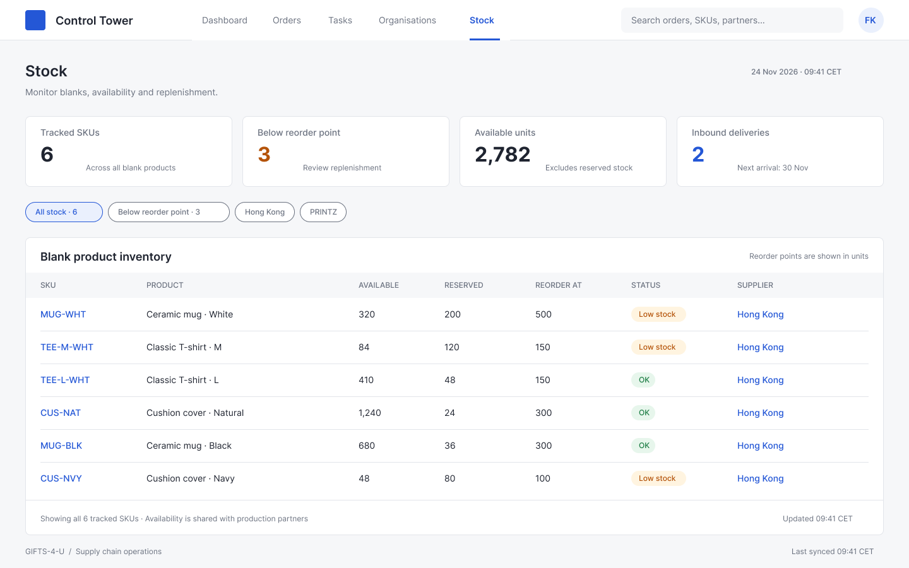

# Prototype
 
High-fidelity, clickable prototype of the Control Tower and webshop for situations 1–6.
 
**Figma (clickable):** https://www.figma.com/design/LcL2jfRR8PBWRim1kKnYaz/prototype?t=z0G97AdUJKZ7B1Do-1
 
Open the link, press **Present** (▶) and start from "Start · Choose a situation".
 
PO-N - Purchase Order, N - order number
 
| Situation | Flow |
|---|---|
| 1 Christmas rush | Dashboard popup -> Tasks -> New purchase order -> PO-104 confirmed |
| 2 SKU shortage | Dashboard popup → Affected orders -> PO-102 out of stock -> Customer view |
| 3 B2B priority | Dashboard popup -> B2B task -> Orders -> PO-105 confirmed |
| 4 Printer fault | Dashboard popup -> Tasks -> PRINTZ -> Customer view |
| 5 DHL late shipment | Dashboard popup -> Tasks -> DHL -> Customer view |
| 6 Return: wrong photo | Return form -> Confirmation -> Dashboard popup -> Tasks -> PRINTZ reprint |
 
## When you start presenting
 
**Start · Choose a situation**
 

 
**Dashboard**
 

 
**Orders**
 

 
**Tasks & exceptions**
 

 
**Stock**
 

 
**Organisations · Hong Kong**
 

 
**Organisations · PRINTZ**
 

 
**Organisations · DHL**
 

 
**My order · ORD-1842**
 

 
## Wireflows
 
### Situation 1 – Christmas rush
 
**1 Christmas-rush alert**
 

 
**2 Replenishment tasks**
 

 
**3 New purchase order**
 

 
**4 PO-104 confirmed**
 

 
### Situation 2 – SKU shortage
 
**1 Supplier-shortage alert**
 

 
**2 Affected customer orders**
 

 
**3 PO-102 out of stock**
 

 
**4 Customer ORD-5543**
 

 
### Situation 3 – B2B priority
 
**1 New B2B-order alert**
 

 
**2 B2B priority task**
 

 
**3 Stock reserved for B2B**
 

 
### Situation 4 – Printer fault
 
**1 Dashboard alert**
 

 
**2 Printer-fault tasks**
 

 
**3 PRINTZ production**
 

 
**4 Customer ORD-5530**
 

 
### Situation 5 – DHL late shipment
 
**1 DHL dashboard alert**
 

 
**2 DHL late-shipment tasks**
 

 
**3 DHL shipments**
 

 
**4 Customer ORD-5534**
 

 
### Situation 6 – Return: wrong photo
 
**My order ORD-5530**
 

 
**1 Return an item**
 

 
**2 Return confirmation**
 

 
**3 New return alert**
 

 
**4 Request reprint**
 

 
**5 PRINTZ reprint requested**
 

 
