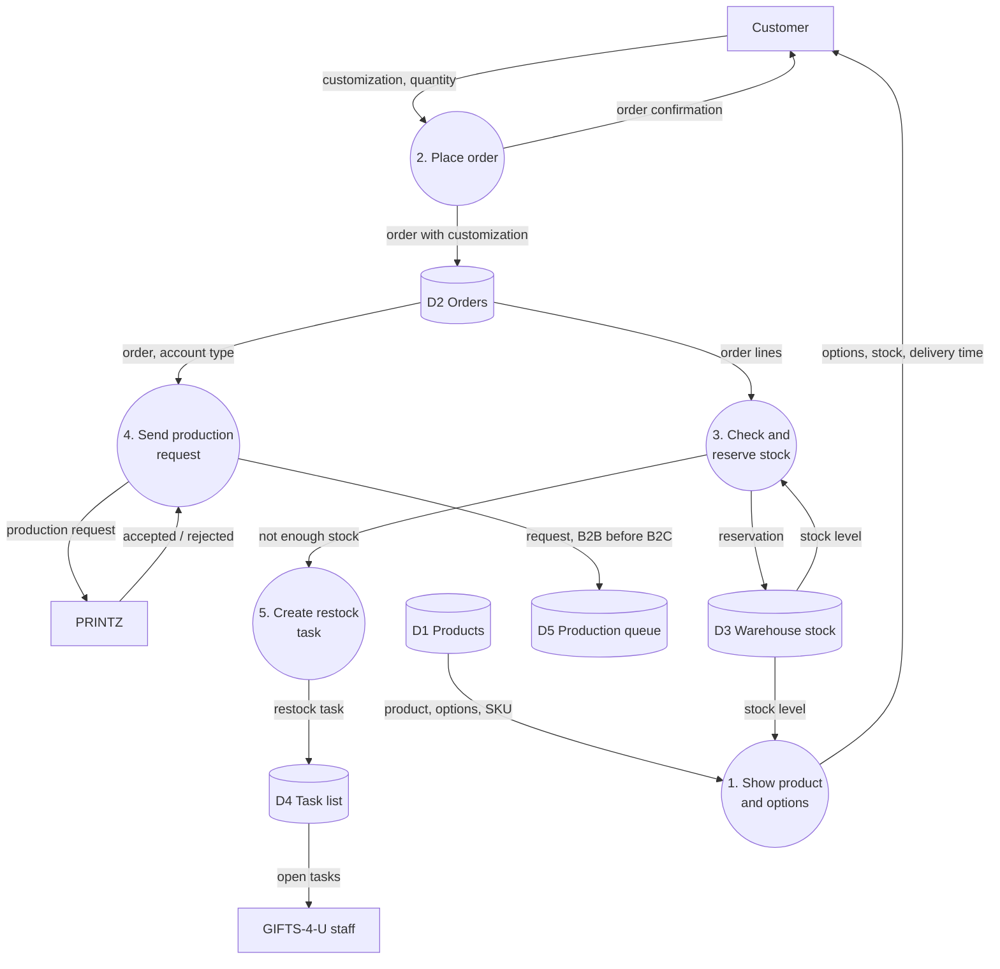
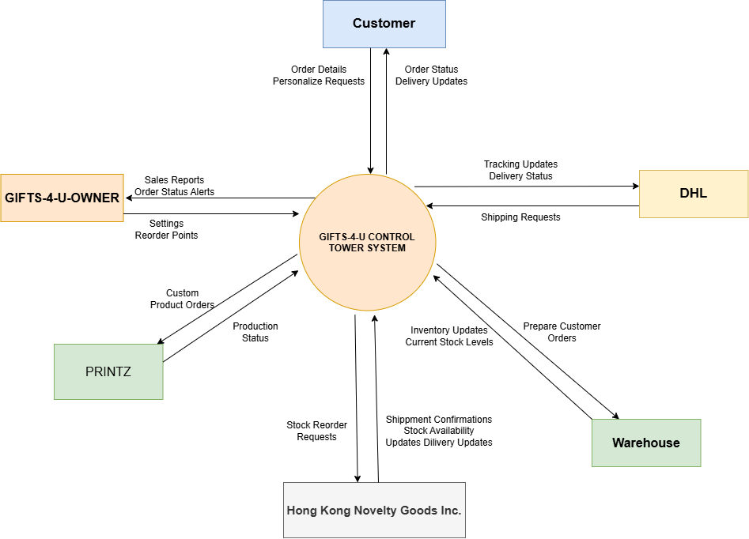

# Sprint 1 – report

| Field | Value |
|---|---|
| Start date | 16-11-2026 |
| End date | 29-11-2026 |
| Sprint # | 1 |
| Group | Group 1 (GitHub: fork-around-and-find-out) |
| Students | Lukas (LukasBooCode) Dari (DariMasu) Ula (gedvula) Andries (Andrei-Cristiann) Tyrone (Tyrone123457890) |
| Topic | GIFTS-4-U supply chain Control Tower: one platform connecting the webshop, warehouse, Hong Kong Novelty Goods (supplier), PRINTZ (production) and DHL (transport) |

## Related System requirements (sprint backlog)

Sprint 1 was the analysis and design sprint. The requirements list (55 FRs, 16 NFRs) was written and validated with the client. The use cases modelled this sprint cover these requirements:

- FR19 – Customers can order customizable products (size, letters, colours)
- FR23 / FR24 – Delivery time and warehouse stock level shown per product in the webshop
- FR27 – Multiple products in one order
- FR34 / FR35 – Production request with all customization details sent to PRINTZ automatically
- FR48 – B2B production orders get priority over B2C orders
- FR5 – Task for the Control Tower when there is not enough stock for an order
- FR6 / FR7 / FR12 – Reorder threshold per product, automatic reorder, purchase order to Hong Kong
- FR31 / FR32 / FR33 – Supplier can/cannot fulfil, expected arrival (2 weeks + delay), all-or-nothing shipping
- FR25 / FR26 – Customers confirm an order arrived or report a problem in the webshop
- NFR1, NFR2, NFR3, NFR15 – Email alerts for B2B issues, unique SKUs, dispatch within 5 working days, microservice architecture

## Tasks

| Task | Assignee | Estimated hours | Spend hours | Progress |
|---|---|---|---|---|
| #3 Requirements list | Dari, Ula, Lukas, Tyrone | 8 | Not logged | Done (PR #11) |
| #10 Prepare requirements list for review | Dari | 2 | Not logged | Done |
| #4 Persona sheet (Gifts-4-U owner) | Andries | 3 | Not logged | Done (PR #6) |
| #7 Journey map (CEO) | Andries | 4 | Not logged | Done (PR #14) |
| #9 Use case diagram | Lukas | 3 | Not logged | Done (PR #12) |
| #8 DFD level 0 | Tyrone | 3 | Not logged | Done (PR #41) |
| #16 Use case specifications (3) | Lukas | 6 | Not logged | Done (PRs #26, #27, #28) |
| #17 Activity diagrams (3) | Lukas | 5 | Not logged | Done (PRs #31, #32, #34) |
| #15 ERD (whole system) | Dari | 5 | Not logged | Done (PR #33) |
| #24 Component diagram | Dari | 3 | Not logged | In review (PR #56) |
| #22 API message designs (LDOs) | Dari | 5 | Not logged | Done (PRs #35–#38, #40, #64) |
| #19 UXD testing plan | Ula, Tyrone | 3 | Not logged | Done (PR #50) |
| #18 Wireframes | Andries | 4 | Not logged | In review (PR #67) |
| #20 Wireflows | Ula, Andries | 4 | Not logged | To do |
| #21 High-fidelity prototype | Ula | 8 | Not logged | To do |
| #23 API specifications (Swagger) | Unassigned | 6 | Not logged | To do |
| #54 User story backlog | Lukas | 4 | Not logged | In review (PR #63) |
| #5 Invite Mike to organization | Ula, Lukas | 0.1 | Not logged | Done |
| #44 Enable repository wiki | Lukas | 0.1 | Not logged | Done |
| #45 Adapt issue templates | Lukas | 0.1 | Not logged | Done (PR #48) |
| #46 Choose a development pipeline (wiki) | Tyrone | 0.3 | Not logged | Done (wiki page "CIN development pipeline") |
| #47 Trigger build on push | Dari | 0.5 | Not logged | Done |
| #49 Inform developers on build fail | Dari | 0.5 | Not logged | To do |
| #51 Unit tests (wiki) | Unassigned | 1 | Not logged | To do |
| #52 Using pull requests (wiki) | Unassigned | 1 | Not logged | To do |
| #53 Branching model (wiki) | Ula | 2 | Not logged | To do |
| #55 Sprint report 1 | Tyrone | 5 | Not logged | In review |
| #60 Update project risks | Lukas | 1 | Not logged | Done |
| #61 Update requirements priority | Dari | 1 | Not logged | In review (PR #68) |
| #62 Review pull requests | Lukas | 1 | Not logged | Done |
| #65 Update and correction | Lukas | 1 | Not logged | To do |
| #66 Update and correction UML component diagram | Dari | 1 | Not logged | To do |

Note: estimated hours for issues created on 23-11 come from the "Estimated time" field in GitHub; the other estimates were made for this report. Spent hours were not logged on the issues during sprint 1, so they are marked "Not logged". From sprint 2 every issue gets its spent hours in the "Time taken" field (see the retrospective).

## Retrospective summary

| Field | Value |
|---|---|
| Start | Logging estimated and spent hours on every issue, so planning can be compared with reality. Committing diagrams as text (Mermaid/PlantUML) where possible, like the LDOs, so changes can be reviewed in the PR. Linking every PR to its issue with "Closes #". Spreading the work: every student makes at least two PRs per sprint. Starting UI work earlier: wireframes, wireflows and prototype depend on each other and are still open. |
| Stop | Merging PRs without a review (#11, #25, #42, #43). Leaving duplicate or stale branches and PRs open (three old DFD PRs). Giving feedback outside GitHub (e.g. via Discord), where it is not traceable. |
| Keep | One issue per deliverable, and one branch and PR per issue. Detailed peer reviews that request changes before approving (e.g. PRs #12, #14, #32, #33). Keeping scope simple, as Mike advised: cutting the PRINTZ rejection path and leaving exception flows out of activity diagrams. |

## Test (for sprint 2 and 3 only)

Summary of the test: not applicable, testing starts in sprint 2.

| Field | Value |
|---|---|
| Start | Not applicable for sprint 1 |
| Stop | Not applicable for sprint 1 |
| Keep | Not applicable for sprint 1 |

## Demo

Summary of the demo: the sprint 1 demo is on 30-11-2026 (milestone "demo 1") for Mike. We show the analysis and design products of this sprint from the main branch: the requirements list, persona, journey map, use case diagram, the three use case specifications with their activity diagrams, the ERD, the DFDs, the API message designs (LDOs), the component diagram, the UXD testing plan and the wireframes. Each student presents the products they made. The points below are the team's agreements for the demo; Mike's feedback is processed in the sprint 2 backlog and report.

| Field | Value |
|---|---|
| Start | Rehearsing the demo together the day before and agreeing who presents which product. |
| Stop | Merging pull requests right before the demo without a review. |
| Keep | Showing every product straight from the repository, so the issue → PR → review trail is visible. |

## Design documentation

### Use Case Specification

Chosen use case: Order Custom Product. It is the most complex use case of this sprint, because it connects the webshop, the warehouse and PRINTZ, and has B2B priority. Source: products/order-custom-product-use-case.md. Activity diagram: products/order-custom-product-activity-diagram.png.

| Field | Value |
|---|---|
| Use case name | Order Custom Product (FR19) |
| Actor(s) | Customer (Consumer or Business) |
| Summary description | The Customer creates a custom gift in the GIFTS-4-U webshop by choosing a blank product (e.g. a white mug or teddy bear) and specifying its size, letters and colors, then places the order after checking the stock level and estimated delivery time. The system automatically sends a production request with all customization details to PRINTZ. The use case covers three decision points: whether the blank item is in stock, whether PRINTZ accepts the customization details, and whether the order is a B2B order that moves ahead in the production queue. |
| Priority | Must-Have |
| Status | Uncommenced |
| Pre-condition | The Customer is logged in to a GIFTS-4-U webshop account registered as either Consumer or Business (see Create Account). The product is offered in the webshop as a customizable item, with its size, letter and color options defined. |
| Post-condition | The order is recorded with all customization details, and the Customer has received an order confirmation with the order number and estimated delivery time. PRINTZ has accepted a production request for each customized product in the order, queued with B2B orders ahead of B2C orders. The blank items for the order are reserved in warehouse stock for shipment to PRINTZ, or a restocking task is on the staff task list. |
| Basic path | 1. The Customer opens a customizable product in the GIFTS-4-U webshop. 2. The system displays the product with its customization options for size, letters and colors (FR19), the number of blank items in stock in the warehouse (FR24), and an estimated delivery time based on supply chain factors such as stock levels and busy periods (FR23). 3. The Customer chooses the size, enters the letters, selects the colors and enters the quantity (FR19). 4. The Customer adds the customized product to the cart. 5. The Customer proceeds to checkout. 6. The system displays an order summary listing each product with its customization details and quantity, together with the estimated delivery time for the whole order (FR23, FR27). 7. The Customer confirms and places the order. 8. The system records the order and checks that the warehouse has enough blank items in stock for each customized product. Stock is available, so the system reserves the blank items for shipment to PRINTZ. 9. The system automatically sends a production request to PRINTZ for each customized product (FR34), containing all customization details (letters, colors, size), the product specification, the SKU and the order number (FR35). 10. The system identifies the order as B2C from the Customer's account type and adds the production request to the end of the PRINTZ production queue (B3). 11. The system shows the Customer an order confirmation with the order number and the estimated delivery time. 12. PRINTZ checks the customization details and accepts the production request. The use case ends. |
| Alternative paths | A1. Several products in one order (at step 4): A1.1 The Customer continues shopping and repeats steps 1–4 for other customizable products, or adds pre-made products to the cart. A1.2 All products in the cart are placed as one order (FR27). Continue at step 5. A2. Blank item not in stock (at steps 2 and 8): A2.1 At step 2, the system shows that the blank item is out of stock or low on stock (FR24) and displays a longer estimated delivery time that includes restocking (FR23). The Customer can still order the product. A2.2 At step 8, the system finds that the warehouse does not have enough blank items to complete the order and automatically adds a restocking task to the GIFTS-4-U staff task list (FR5). For a B2B order it also sends an email alert (NFR1). A2.3 The system includes the restocking time in the estimated delivery time (B5). Continue at step 9; the blank items are shipped to PRINTZ once they are back in stock, and the confirmation in step 11 shows the extended delivery time. A3. B2B order (at step 10): A3.1 The system identifies the order as B2B because the Customer's account is registered as Business (B4). A3.2 The system places the production request ahead of all B2C requests in the PRINTZ production queue, behind any earlier B2B requests (FR48). Continue at step 11. Exception path: E1. Customization incomplete (at step 4): E1.1 The Customer tries to add the product to the cart without specifying the size, letters or colors. E1.2 The system highlights the missing fields and does not add the product to the cart (B1). Resume at step 3. |
| Business rules | B1. A customized product can only be added to the cart once size, letters and colors are all specified, using only the options offered for that product. B2. Each customized product in an order gets its own production request, linked to the order number and the product's SKU. B3. B2B production requests are processed before B2C requests; requests of the same type are processed in order of arrival (FR48). B4. An order is B2B or B2C according to the account type (Business or Consumer) the Customer chose when creating the account. B5. When there are not enough blank items in stock, the order is still accepted, but the estimated delivery time must include the restocking time (FR5, FR23). B6. A rejected production request is not produced until corrected customization details have been received (FR43, FR44). |
| Non-functional requirements | NFR1. The system shall send alerts about issues with B2B orders by email, such as a rejected production request or missing blank stock. NFR2. The system shall identify every product by a unique, standardized SKU; the production request to PRINTZ refers to the blank item by its SKU. NFR3. The warehouse shall dispatch an order within 5 working days of the order. In this use case it applies when the blank item is in stock (see B5). NFR4. The system shall have an adjustable polling time for warehouse stock checks, so the stock level shown on the product page (FR24) stays current. NFR7. The system shall show all dates and times in CET, including the delivery times shown to the Customer. NFR9 / NFR10 / NFR11. A product title is at most 50 characters, a summary at most 100 characters and a product image at most 2 MB on the product page the Customer opens in step 1. |

### Dataflow Diagram

Data flow diagram of the Order Custom Product use case. Processes are numbered, data stores start with D, external entities are rectangles.

For context, the level 0 DFD of the whole system (products/UCV DFD.png, PR #41):

### API specification and Message(s)

API message designs (logical data objects) are in review as Mermaid diagrams for the control tower, DHL, Hong Kong, PRINTZ, warehouse and webshop (issue #22, PRs #35–#40). The API specifications (issue #23, Swagger) are not started yet.

### Release

No release yet. Sprint 1 produced analysis and design products only; the first release is planned once implementation starts.

### Pull request

Every student should code. This table relates each pull request to its GitHub issue and to a task above. When an issue is finished, a pull request is created and one of the other students reviews it and either rejects or accepts it. Every sprint, each student should make at least two pull requests.

| Nr | Issue | Task | Responsible | Reviewed |
|---|---|---|---|---|
| #6 | #4 | Persona sheet | Andries | Dari (comments), Ula (approved) |
| #11 | #3 | Requirements document | Dari | No review on the PR |
| #12 | #9 | Use case diagram | Lukas | Dari (changes requested, then commented) |
| #14 | #7 | Journey map | Andries | Ula (comments), Lukas (approved) |
| #25 | #45 | Issue template: time fields | Lukas | No review |
| #26 | #16 | UCS Order custom product | Lukas | Dari (approved) |
| #27 | #16 | UCS Re-order stock | Lukas | Dari (approved) |
| #28 | #16 | UCS Customer confirms/reports order | Lukas | Dari (approved) |
| #31 | #17 | Activity diagram Order custom product | Lukas | Dari (approved) |
| #32 | #17 | Activity diagram Re-order stock | Lukas | Dari (approved) |
| #34 | #17 | Activity diagram Customer report | Lukas | Dari (approved) |
| #33 | #15 | ERD (whole system) | Dari | Lukas (approved) |
| #41 | #8 | DFD level 0 | Tyrone | Lukas (approved) |
| #42 | No issue | Relocate journey map | Lukas | No review |
| #43 | No issue | Relocate DFD | Lukas | No review |
| #48 | #45 | Issue template: new product types | Lukas | Dari (approved) |
| #35–#38, #40, #64 | #22 | LDOs (6 microservices) | Dari | Lukas (approved; #39 replaced by #64) |
| #50 | #19 | UXD testing plan | Ula | Lukas (approved) |
| #59 | No issue | Update Hong Kong service requirements | Ula | Lukas (approved) |
| #56 | #24 | Component diagram | Dari | Open, awaiting review |
| #58 | #55 | Sprint report 1 (first version) | Tyrone | Lukas (changes requested; replaced by the final sprint report PR) |
| #63 | #54 | User stories | Lukas | Open, awaiting review |
| #67 | #18 | Wireframes | Andries | Open, awaiting review |
| #68 | #61 | Requirements priority rating | Dari | Open, awaiting review |
